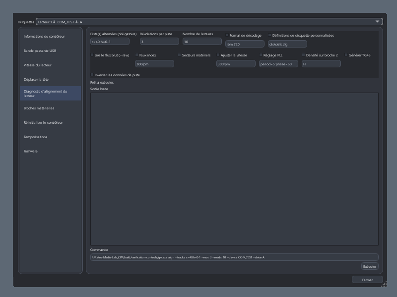
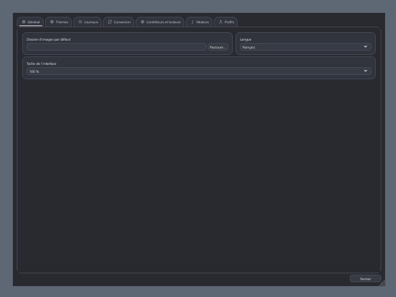

# Captures 800 × 600

Captures conservées le 14 novembre 2026 à la demande de l’utilisateur.

- Rendu réel des widgets C++/Qt du thème RetroMediaLab, en mode sombre, dans un écran virtuel hors écran sous Windows.
- Résolution du profil : 800 × 600 pixels ; facteur système simulé : 100 % ; réglage Taille de l’interface : 100 %.
- Pour une diagonale de 15 pouces, la densité physique calculée serait environ 66.67 PPP. Cette densité est inscrite dans les métadonnées PNG. Elle ne remplace pas un essai sur un moniteur physique.
- Les cadres natifs Windows, le bureau et la barre des tâches ne sont pas simulés. Les vues des dialogues sont assemblées sur la capture du contenu de la fenêtre principale, à leurs positions réelles dans ce profil. Le fond bleu-gris représente uniquement l’espace de bureau virtuel. Aucun contrôle n’est redessiné artificiellement.
- Le lecteur COM_TEST et l’exécutable vide gw.exe sont des données de démonstration du banc. Aucune commande n’est lancée sur du matériel.
- Les captures sont à examiner à 100 % dans un visualiseur pour comparer les tailles en pixels ; un aperçu automatiquement réduit ne représente pas leur taille physique.

| Vue | Dimensions | SHA-256 |
|---|---|---|
| [Application](01-application.png) | 800 × 600 | `375a32664113381e2247e7b8ab189ed8b1a712a0bb635c7b46b806af4ea5e165` |
| [Préférences — Général](02-preferences-general.png) | 800 × 600 | `bed047c15ced5b9a1e543355087569f18bbc68065d6b190497f25f91b59cbd6c` |
| [Préférences — Contrôleurs et lecteurs](03-preferences-controleurs.png) | 800 × 600 | `b546083e2b2b04179e0d73fb92fc140074c957325caedc5d1f11d9919abb3e7b` |
| [Préférences — Profils](04-preferences-profils.png) | 800 × 600 | `574640209a5c6b2304dd59842c9a6baed8da30c6164af49cd67ee8ec26d49da1` |
| [GreaseWeazle — Informations](05-greaseweazle-informations.png) | 800 × 600 | `6094817fba92b1e8f2c314b7c4ce3cdbb4f222d0c4184658e1f147582299acba` |
| [GreaseWeazle — Alignement](06-greaseweazle-alignement.png) | 800 × 600 | `6b0a60a3e23961336127eae90adf51491946dfe26981b5ad2a843a4a8e875f9a` |

## Aperçu GreaseWeazle

## Aperçu Préférences

## Correction : fenêtres normales

Les captures précédentes avec la fenêtre principale maximisée ont été remplacées. Le banc ne demande désormais aucune maximisation, aucun déplacement et aucun redimensionnement. Les dimensions sont celles décidées par l’application à son ouverture : fenêtre principale 752 × 552 pixels, dialogues Préférences et GreaseWeazle 752 × 552 pixels. Sur le profil 800 × 600, le plafonnement à l’espace disponible provient du comportement existant de l’application.

La géométrie a été vérifiée avant et après chaque capture. Les mesures sont conservées dans [geometries.json](geometries.json).

## Contrôles compacts et indicateurs

Captures actualisées après correction des hauteurs et du cache minimum des sélecteurs. La ligne du lecteur calcule sa hauteur après adaptation, sans défilement superflu. Les paramètres GreaseWeazle se répartissent sur plusieurs colonnes selon la place. Aucun redimensionnement ni maximisation n’est demandé par le banc.

Les relevés des 21 pages parcourues figurent dans [controls.json](controls.json) : dimensions des champs et plages de défilement. Les longues listes restent défilables si leur contenu le nécessite.

Comparaison du soulignement des onglets : [50 %](07-onglets-50.png), [100 %](07-onglets-100.png), [200 %](07-onglets-200.png). La fenêtre conserve ses dimensions dans les trois captures.
